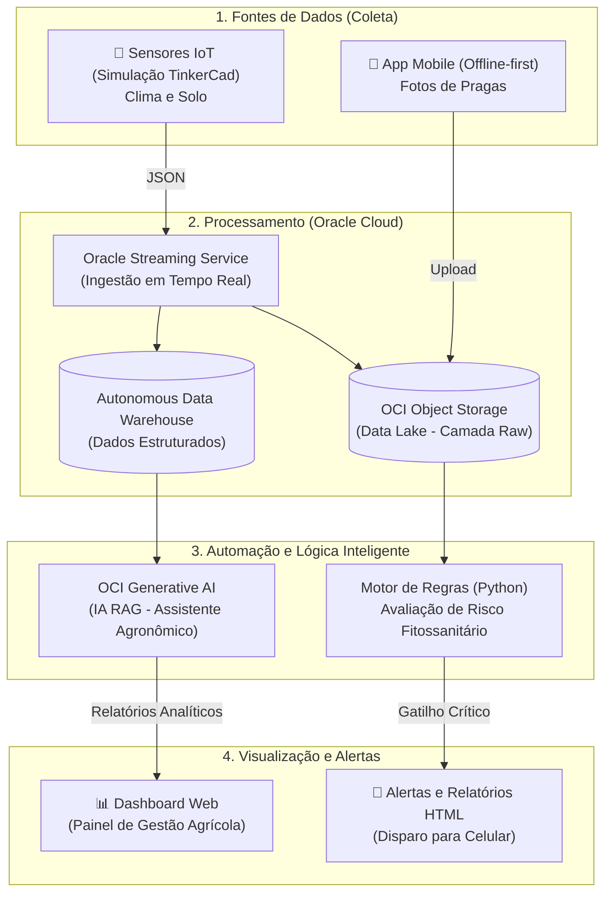

# Evolução do Projeto: AgroSmart / AgriVisionAI - Sprint 6

## 1. Integração da Arquitetura da Solução

O ecossistema AgroSmart consolida a ingestão de dados físicos (sensores) e visuais (aplicativo), processando-os na nuvem da Oracle (OCI) para gerar ações autônomas. A arquitetura foi desenhada para ser elástica, escalável e focada na entrega de valor na ponta (Copiloto Agronômico).

### 1.1 Diagrama Geral da Solução

# 1.2 Descrição dos Componentes do Sistema

## Fontes de Dados (Coleta)
* **Sensores IoT:** Módulos de telemetria instalados nos talhões para medir umidade do solo, temperatura do ar e luminosidade de forma contínua.
* **App Mobile Offline-first:** Aplicativo utilizado pelos agrônomos para capturar imagens de folhas doentes.
* **Arquivos Administrativos (Estruturado):** Histórico de aplicação de defensivos, tipo de solo e datas de plantio/colheita inseridos em formato CSV.

## Processamento e Organização (Ingestão Cloud)
* **Oracle Streaming Service:** Atua como um "para-raios" de dados (compatível com Kafka), absorvendo milhares de leituras IoT por segundo sem sobrecarregar o banco de dados.
* **OCI Object Storage:** O repositório bruto (*Data Lake*) onde imagens pesadas e arquivos JSON/CSV são guardados de forma imutável, a baixo custo e alta segurança.

## Automação e Lógica Inteligente
* **Autonomous Data Warehouse (ADW):** Banco de dados analítico da Oracle que estrutura os dados refinados (Delta Lake / Parquet) para consultas rápidas.
* **Motor de Regras (Python):** Script autônomo que avalia continuamente as métricas para sanitização, validação e inferência.
* **OCI Generative AI (Motor RAG):** Inteligência artificial que cruza o diagnóstico da praga com o clima local e bases de conhecimento agronômico (vetores) para gerar decisões em linguagem natural.

## Visualização e Alertas (Consumo)
* **Alertas Proativos:** E-mails e notificações (WhatsApp/SMS) disparados contendo ordens de serviço e planos de ação.
* **Dashboard Web:** Painel gerencial (React/BI) para visualização de métricas agregadas por talhão e tendências de risco da safra.
