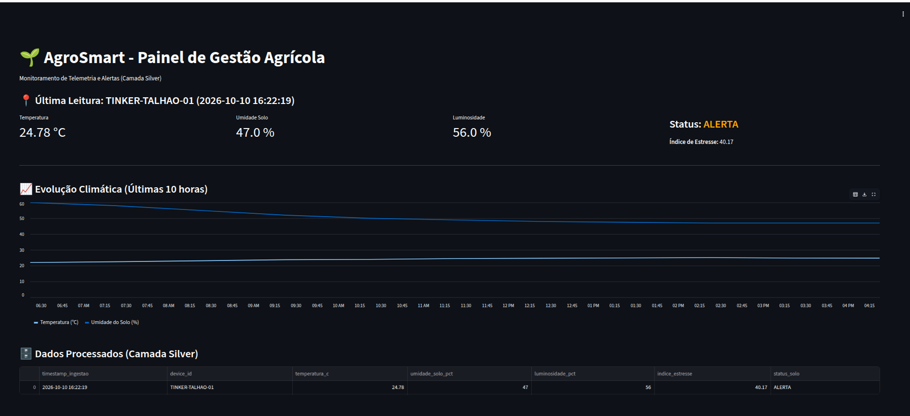

## 5. Dashboard Analítico da Solução

Para a visualização dos dados, desenvolvemos um dashboard web interativo utilizando a framework **Streamlit** (Python). O painel consome os dados processados da camada *Silver* do nosso Data Lake e apresenta a situação do campo em tempo real para o gestor agrícola.

### 5.1 Descrição dos Indicadores Utilizados

O painel foi estruturado para fornecer uma visão tática e rápida, exibindo os seguintes indicadores (KPIs):
*   **Temperatura Atual (°C):** Monitoramento do microclima para identificar janelas de evaporação.
*   **Umidade do Solo (%):** Indicador crítico para acionamento de irrigação.
*   **Índice de Estresse Hídrico:** Métrica de negócio calculada na etapa de processamento. Valores acima de 40 indicam alerta, e acima de 60 indicam risco crítico.
*   **Status do Talhão:** Classificação textual imediata (IDEAL, ALERTA ou CRÍTICO) que direciona a ação do operador.

### 5.2 Evolução Histórica e Alertas
O dashboard apresenta um gráfico de linhas contendo a evolução térmica e hídrica das últimas leituras, permitindo prever tendências de seca. Além disso, a tabela de telemetria exibe o registro exato de quando o status de "ALERTA" ou "CRÍTICO" foi acionado pelo motor de automação.

### 5.3 Capturas e Acesso ao Dashboard

*O painel roda localmente (Localhost) durante a simulação ou pode ser hospedado em nuvem.*

*   **Link de Acesso (Simulação Local):** `http://localhost:8501`